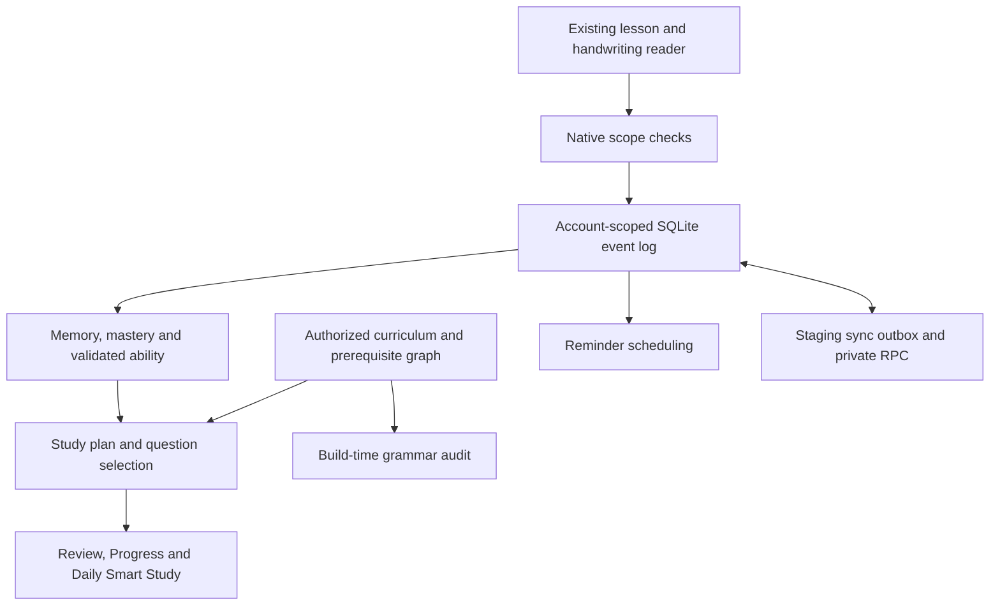

# Nihongo Path Adaptive Learning Engine

The adaptive engine consumes answer events from the existing Android lesson
reader. The native bridge checks the current account, reader scope and
entitlement before accepting an event. Supabase access uses the existing
opaque app session; no service role credential enters the Android bundle.

| Module | Input | Output and implementation |
| --- | --- | --- |
| Memory Intelligence | Item ID, rating, review timestamp | ts-fsrs 6.0.1 tracks card difficulty and stability, retrieves recall probability and calculates review intervals at the internal 90% target. State is reconstructed from durable history. |
| Knowledge Intelligence | Ordered answer outcomes and curriculum | The four-state forward pass supplies beliefs. BKT uses the same emissions, with the mastered probability derived from the same update. Verified prerequisite edges form a DAG. Exact word/character relationships and source-provided readings, meanings and radicals are represented separately. |
| Adaptive Question | Ability, beliefs and eligible exercises | Rasch emissions, Shannon expected information gain, PID limits and delayed-correctness Thompson estimates select exercise variants. Official papers have a separate content and scoring path. |
| Handwriting Intelligence | Ordered pen paths and existing reference paths | DTW compares normalized shape and checks reversed direction and likely mismatched stroke order. Count, placement and scale are assessed independently. Only the latest assessment summary per glyph is retained locally. |
| Grammar Intelligence | Formation clauses from the Books curriculum | An offline two-part MDL audit proposes bounded reversible rewrites. The full corpus was read without modifying curriculum rows. |
| Learning Optimization | Memory, mastery, diagnostic utility, duration and load | Weighted optimization over the feasible time and load frontier with prerequisite filtering. The plan is recomputed with new answers. |
| Study Habit Intelligence | Recent answer session starts | A fitted exponential Hawkes kernel plus observed hour eligibility chooses a reminder slot. The native daily notifier handles permissions, quiet hours and at most one per day. |
| Model Validation | Chronologically ordered outcomes | A regularized Rasch fit requires at least 60 outcomes with both result classes in train and holdout. Acceptance requires better held-out log loss than the default by at least 0.005. |

## Persistence and sync

- SQLite stores ordered learning attempts, an upload outbox, a per-user sync
  cursor and the latest handwriting assessment by glyph and level. FSRS,
  knowledge beliefs, question priors and daily plans are deterministic
  projections of the saved outcomes and versioned application data. The
  personal ability is recalculated from recent attempts.
- Sync pushes UUID-keyed attempts and pulls monotonic cursor pages. The
  migration applies a private events table and service-only gateway with
  session-owner isolation. Handwriting summaries stay local. Existing account
  deletion cascades the new cloud event records and removes local history.
- Reminder settings use the app's existing local preferences. There is no
  persistent training service. The Android release preview keeps adaptive sync
  disabled unless the compatible server has been installed and verified.

## Rollback and release gates

1. Before deployment, export the staging schema and retain the known-good
   app/Edge revision. Test migration and rollback on disposable accounts.
2. For a cloud rollback, turn off adaptive sync in the app rollout and remove
   or revoke the adaptive route/RPC. Keep the private event table so recorded
   reviews can be replayed after recovery. No existing application tables
   require rollback.
3. Do not upload a production update until the exact published version,
   migration on an upgrade install, AdMob reward and entitlement, login,
   offline/reconnect, cancellation and notification behavior have passed
   device verification. No cloud migration or Play update was performed.
